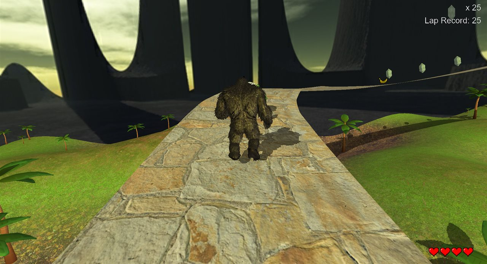
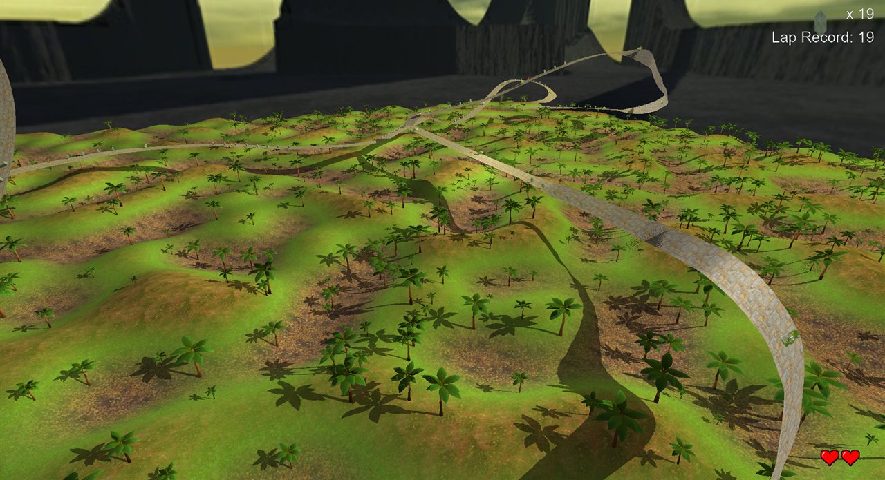
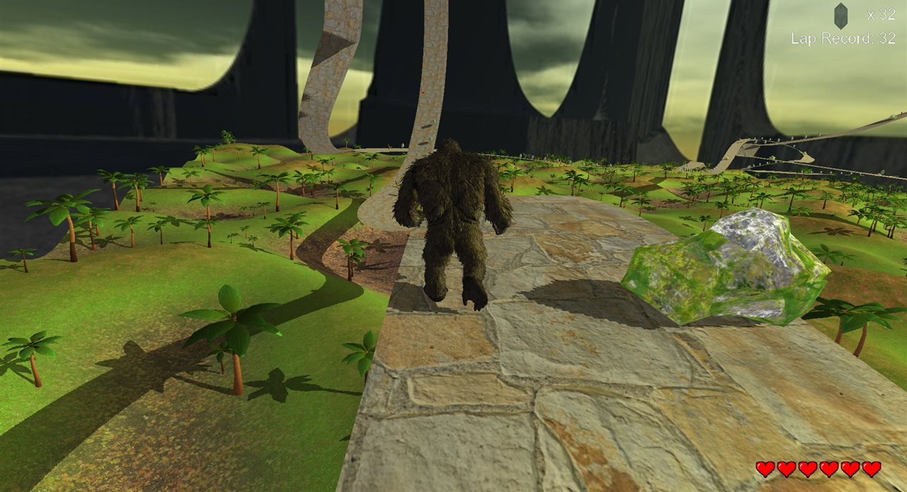
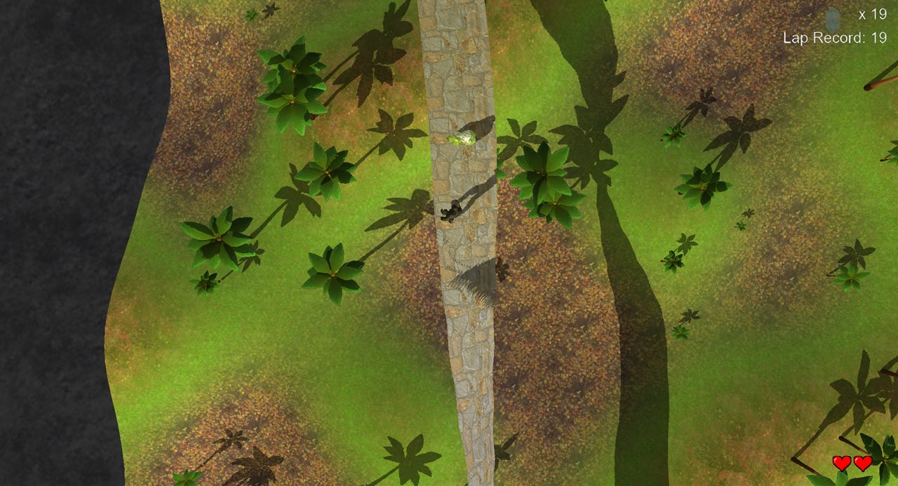
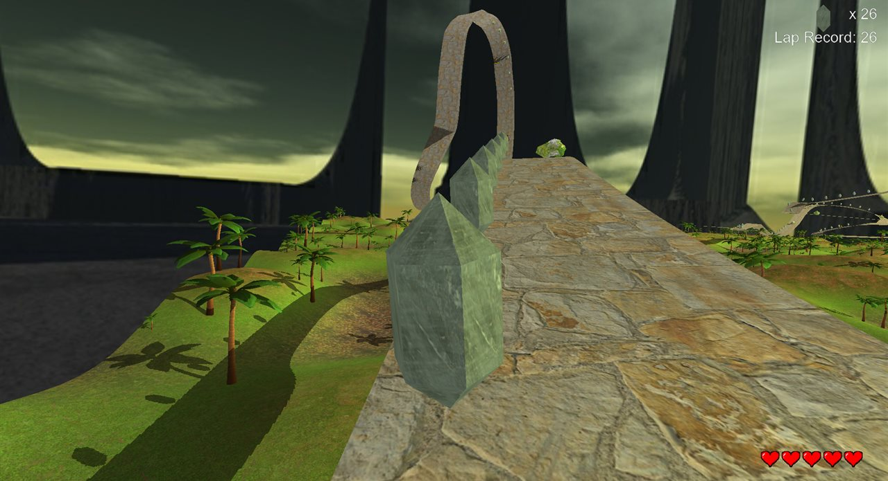
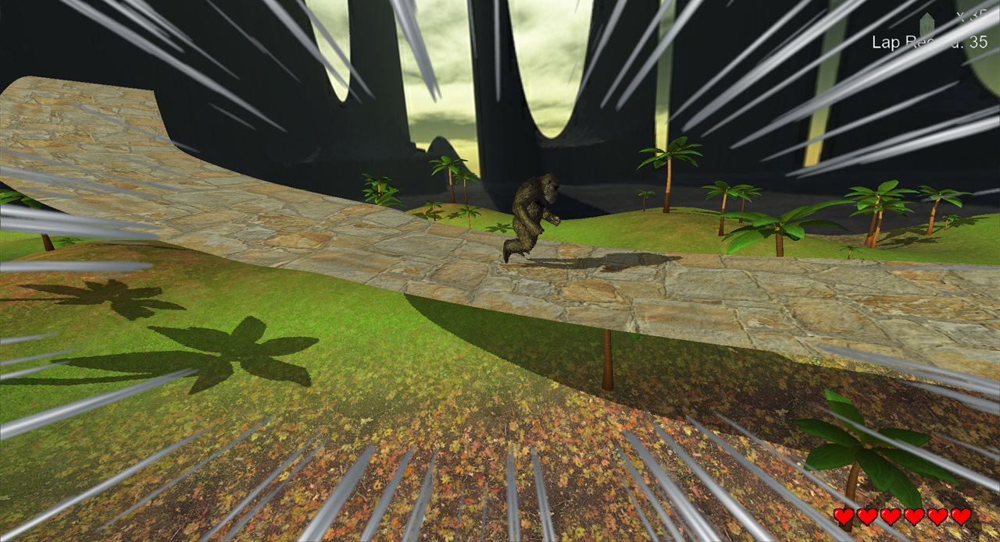
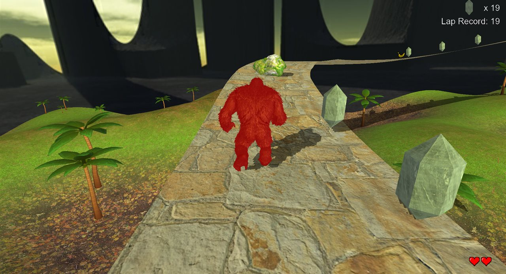

<h1 align="center">🐒 Monke Engine</h1>

<p align="center">
  A small C++20 / OpenGL engine built around a data‑driven Entity Component System,<br>
  with a lane‑switching endless‑runner demo where a gorilla sprints laps of a looping spline track.
</p>

<p align="center">
  
  
  
  
</p>

<p align="center">
  
</p>

---

## Highlights

**Engine**
- **Entity Component System**: entities are composed from components declared in a plain‑text config file ([`entities.cfg`](MonkeEngine/resources/entities.cfg)). Components self‑register with a factory registry, so adding a new one needs no changes to the parser.
- **Entity templates**: any entity in the config can be cloned at runtime (`SpawnEntityFromTemplate`). This is how the 1,000 palm trees and every pickup are spawned.
- **Event system**: an observer‑pattern bus (`std::any` payloads) that decouples input (`KeyDown`) and physics (`OnCollision`) from gameplay.
- **AABB collision**: per‑frame overlap tests between active colliders, which broadcast collision events.
- **Render queue**: components submit `RenderData` and the renderer draws it, automatically batching identical mesh and shader pairs into **instanced draw calls**.
- **Five camera modes** using the strategy pattern (follow, first‑person, side, top‑down, free), plus a *path‑builder* camera used to record tracks.

**Graphics**
- **Shadow mapping**: a depth pass from the sun into an 8192² framebuffer, sampled by every lit shader.
- **Skeletal animation**: Assimp‑loaded FBX rig with **GPU skinning** (up to 4 bone influences per vertex).
- **Procedural terrain**: Perlin noise evaluated **in the vertex shader**, normals from finite differences, and height‑based **multitexturing** (mud, grass, rock). Trees are displaced by the same noise function so they sit on the surface.
- **Catmull‑Rom track**: a spline through recorded control points that stores an *up vector* per point, so the track can bank and loop. The textured mesh with three lanes is generated from offset curves.
- **Toon shading and outlines**: quantised diffuse lighting and inverted‑hull outlines for the hearts and bananas.
- Phong lighting with multiple lights, a cubemap skybox, an additive sun glow, and a FreeType HUD.

**Gameplay**
- Switch between **three lanes** while the gorilla runs automatically.
- 💎 **Crystals** add to your lap score, and the best lap is kept as the **lap record**.
- ❤️ **Hearts** restore health. 🪨 **Fences** cost a heart and trigger a red invulnerability flash.
- 🍌 **Bananas** give a speed boost, with an FOV kick and a speed‑lines overlay.
- Pickups and obstacles are re‑randomised in batches every lap.

## Gallery

| | |
|:---:|:---:|
|  |  |
| Perlin‑noise terrain with 1,000 instanced palm trees | Real‑time shadow mapping |
|  |  |
| Top‑down camera | First‑person camera with a track loop ahead |
|  |  |
| Banana speed boost: wider FOV and speed lines | Hitting a fence: damage flash and recovery |

## Controls

| Key | Action |
|---|---|
| <kbd>A</kbd> / <kbd>←</kbd>, <kbd>D</kbd> / <kbd>→</kbd> | Switch lane (strafe in free camera) |
| <kbd>Tab</kbd> | Cycle camera: Follow → First‑person → Side → Top‑down → Free |
| <kbd>W</kbd> / <kbd>↑</kbd>, <kbd>S</kbd> / <kbd>↓</kbd> | Move forward / back (free camera) |
| Mouse | Look around (free camera) |
| <kbd>Esc</kbd> | Quit |

## Building and running

**Requirements:** Windows 10/11 (x64) and Visual Studio with the **Desktop development with C++** workload.

1. Clone the repository and open **`MonkeEngine.sln`**.
2. Select the **`x64`** platform and the `Debug` or `Release` configuration.
3. Press <kbd>F5</kbd>.

All third‑party headers, import libraries and runtime DLLs are in the repo, so nothing else needs installing. A post‑build step copies the DLLs next to the executable. The debugger's working directory is set to `MonkeEngine/`, because assets are loaded relative to that folder. If you launch the `.exe` by hand, start it from `MonkeEngine/` too.

> The project targets the **v145** toolset (Visual Studio 2026). On Visual Studio 2022, accept the *Retarget Projects* prompt or set *Platform Toolset* to **v143**.

## Project structure

```text
MonkeEngine.sln
MonkeEngine/
├── src/
│   ├── Core/             Game loop, window & GL context, timer, FMOD audio, event system
│   ├── ECS/              Entity, Component, ComponentRegistry, EntityParser
│   │   └── Components/   Mesh, Material, Shader, Collider, Collectible, PlayerTrackMovement,
│   │                     CurrencyManager (pickups/health/score), TreeMesh, CatmullRom, ...
│   ├── Rendering/        Renderer & render queue, shaders, textures, cubemaps, FBOs, VBOs,
│   │                     Assimp mesh loader (with skinning), FreeType fonts
│   ├── Cameras/          CCamera + camera-mode strategies
│   └── Geometry/         Catmull-Rom track, Perlin terrain plane, skybox, crystal/heart/sun shapes
├── resources/
│   ├── entities.cfg      Data-driven entity definitions
│   ├── shaders/          GLSL: Phong + shadows, toon, outline, skinning, instancing, UI
│   ├── tracks/           Recorded track control points (position + up vector)
│   ├── shapes/           Vertex data for the procedural crystal, heart and sun
│   └── models/ textures/ skyboxes/ audio/
├── include/ lib/ bin/    Third-party headers, import libraries and runtime DLLs
docs/images/              Screenshots used in this README
```

## How it works

### Frame loop

```text
Update  ─►  entities update  ─►  AABB collision pass ─► OnCollision events  ─►  camera update
Render  ─►  depth pass (sun's orthographic view → shadow map FBO)
        ─►  main pass (skybox, terrain, sun, entity render queue w/ instancing)  ─►  HUD
```

### Defining entities

Everything in the scene comes from [`entities.cfg`](MonkeEngine/resources/entities.cfg). Each block names an entity and lists its components, with properties written as `key:value`:

```ini
EntityName:MC
ShaderComponent shader:mc
ModelViewComponent position:10.0,10.0,10.0 scale:20.0,20.0,20.0
MeshComponent isfbx:true mesh_file_path:resources/models/Kong/kong-2021-rig/source/MC.fbx anim_speed:0.0021
PlayerMovementComponent speed:0.07 height_factor:1
ColliderComponent extents:0.2,0.2,0.2 offset:0,3,0
CurrencyManagerComponent base_currency:Crystal min_batches:10 max_batches:20 ... health:3 max_fences:60
```

### Adding a component

Derive from `Component`, override what you need (`Apply`, `Init`, `Update`, `AddRenderData`), and register it under the name used in the config:

```cpp
namespace
{
    bool registered = []()
    {
        ComponentRegistry::Instance().Register("CatmullRomComponent",
            [](Entity& e, const PropertyMap& props)
            {
                auto& c = e.AddComponent<CatmullRomComponent>();
                c.Apply(props);
            });
        return true;
    }();
}
```

### Recording a new track

`PathBuilderCam` flies forward under mouse control and writes its position and up vector to `C:\Temp\track.csv` at a fixed interval. To use it, uncomment the `PathBuilderCam` line in [`Camera.cpp`](MonkeEngine/src/Cameras/Camera.cpp), record a lap, copy the file into `resources/tracks/`, and point the `CatmullRomComponent file:` property at it.

## Credits

The engine architecture (ECS, events, renderer, cameras, track, terrain, shaders and gameplay) was written by **Artem Korniienko**.

**Starting point:** the window, GL‑context bootstrap and several low‑level helpers (shader, texture, VBO, font and matrix‑stack wrappers) come from the City, University of London **OpenGL template** for IN3005 / INM376 (Dr Greg Slabaugh and Dr Eddie Edwards, with contributions from Ben Humphrey, Michal Bubner, Christophe Riccio, Christy Quinn, Sam Kellett and others). The Assimp mesh loader is based on Etay Meiri's ogldev tutorials (GPLv3); see the header in `OpenAssetImportMesh.h`.

**Libraries:** [GLEW](https://glew.sourceforge.net/), [GLM](https://github.com/g-truc/glm), [Assimp](https://github.com/assimp/assimp), [FreeImage](https://freeimage.sourceforge.io/), [FreeType](https://freetype.org/), [FMOD](https://www.fmod.com/).

**Assets:**
- Gorilla: [Kong 2021 animated run](https://sketchfab.com/3d-models/kong-2021-animated-run-a75d91ceeba4440981d488cf1e670773) (Sketchfab)
- Fence: [Ruined rock fence](https://sketchfab.com/3d-models/ruined-rock-fence-75e2716c378e4a68bac3577303671921) (Sketchfab)
- Palm tree: [Stylized palm tree](https://sketchfab.com/3d-models/stylized-palm-tree-22c3a3d3fb7146cfa22850fa31390e5d) (Sketchfab)
- Banana: [Banana](https://sketchfab.com/3d-models/banana-d48a903d948345e9904fba6e19345f85) (Sketchfab)
- Textures: [ambientCG](https://ambientcg.com/) ([Ground040](https://ambientcg.com/view?id=Ground040), [Bricks075A](https://ambientcg.com/view?id=Bricks075A), [Ground068](https://ambientcg.com/view?id=Ground068)) and a [speed‑lines overlay](https://www.pngall.com/anime-speed-lines-png/download/144093/) (PNGAll)

All third‑party assets and libraries remain the property of their respective authors and are used under their own licences.
